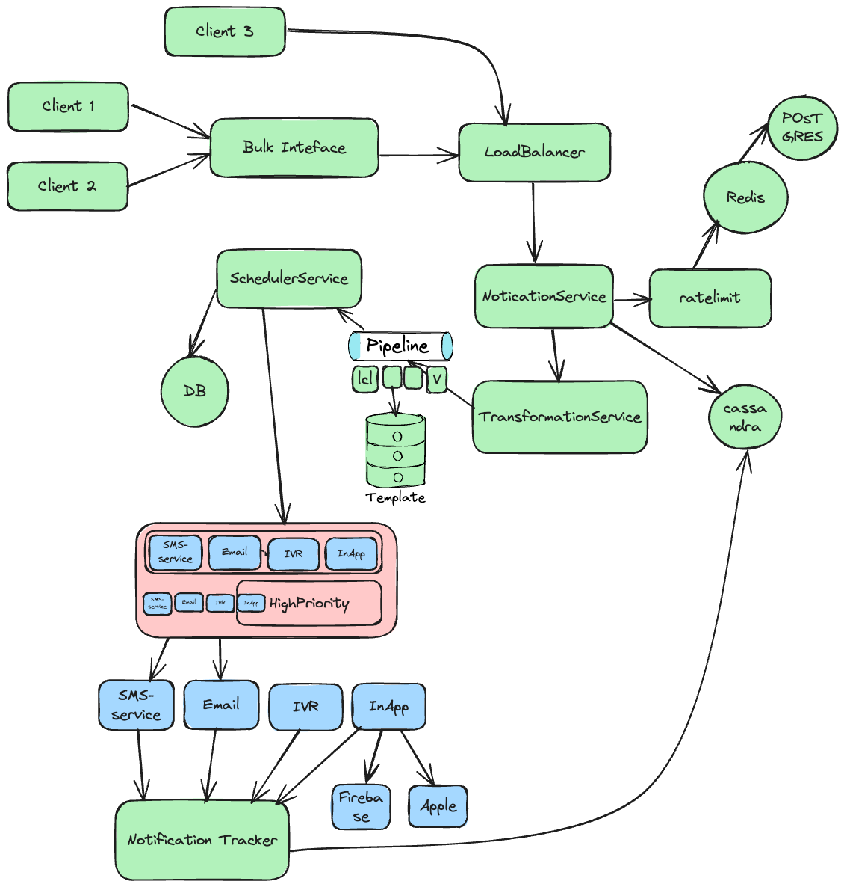

  <section class="studio-hero">
    

      
 UNCODING / ENGINEERING PRACTICE

      <h1>Practice the decisions behind reliable software.</h1>
      
Build backend depth, reason through system design, and prepare for the engineering conversations that move your career forward.

      

        <a class="studio-action-primary" href="/roadmaps.html">Choose a learning path &rarr;</a>
        <a class="studio-action-secondary" href="/interview-questions.html">Practice interview questions ↗</a>
      

      
QUICK FINDSearch any topic above with <kbd>/</kbd>

    

    <a class="featured-exercise" href="/high-level-design.html">
      
DESIGN EXERCISE01 / SYSTEMS

      

        
      

      

        

START WITH THE REQUIREMENTS
<h2>Design a notification service</h2>

        ↗
      

    </a>

  </section>

  <section class="studio-next" aria-labelledby="next-move-title">
    <header class="studio-section-head">
      
Pick your next move

      <h2 id="next-move-title">What are you working on?</h2>
    </header>
    

      <a class="studio-route" href="/coding.html">
        01
        <strong>Build Java & backend depth</strong><small>Collections, concurrency, streams, and practical design</small>
        Explore Java &rarr;
      </a>
      <a class="studio-route" href="/approach-for-system-design.html">
        02
        <strong>Get sharper at system design</strong><small>Requirements, architecture, trade-offs, and reliability</small>
        Start designing &rarr;
      </a>
      <a class="studio-route" href="/problems-to-must-solve.html">
        03
        <strong>Train your problem-solving</strong><small>Core patterns, focused problems, and deliberate review</small>
        Practice problems &rarr;
      </a>
    

  </section>

  <section class="studio-support">
    

Need a second perspective?
<h2>Talk through an interview, design, or career decision.</h2>

    <a href="https://topmate.io/dnnjy" target="_blank" rel="noopener noreferrer">Explore 1:1 mentoring ↗</a>
  </section>

